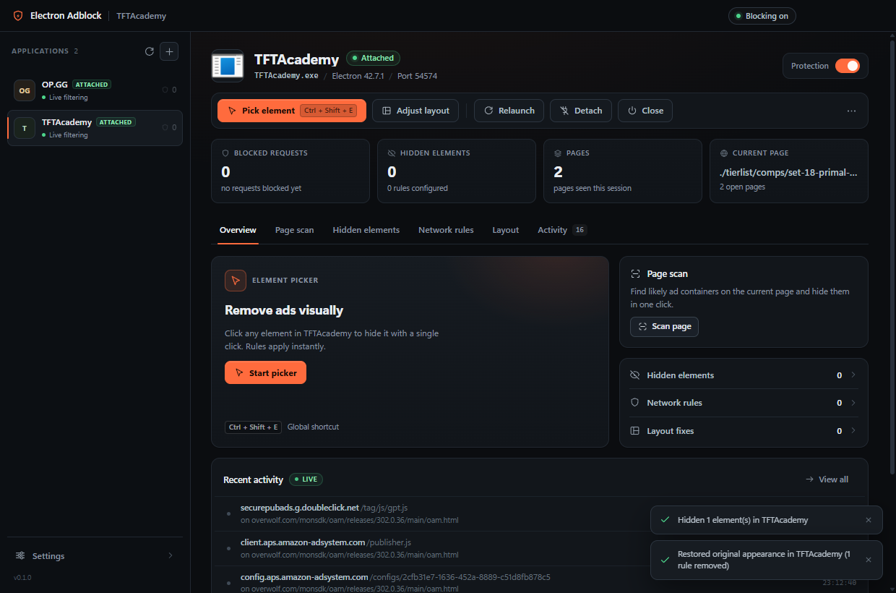
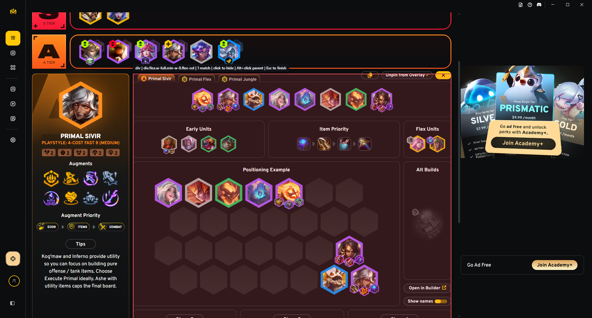
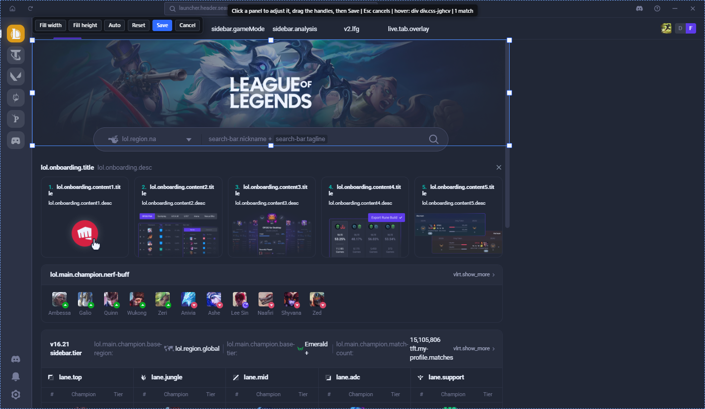
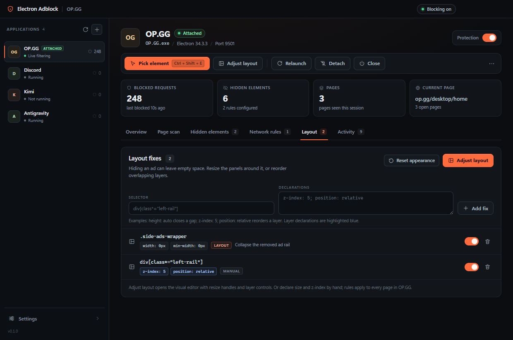
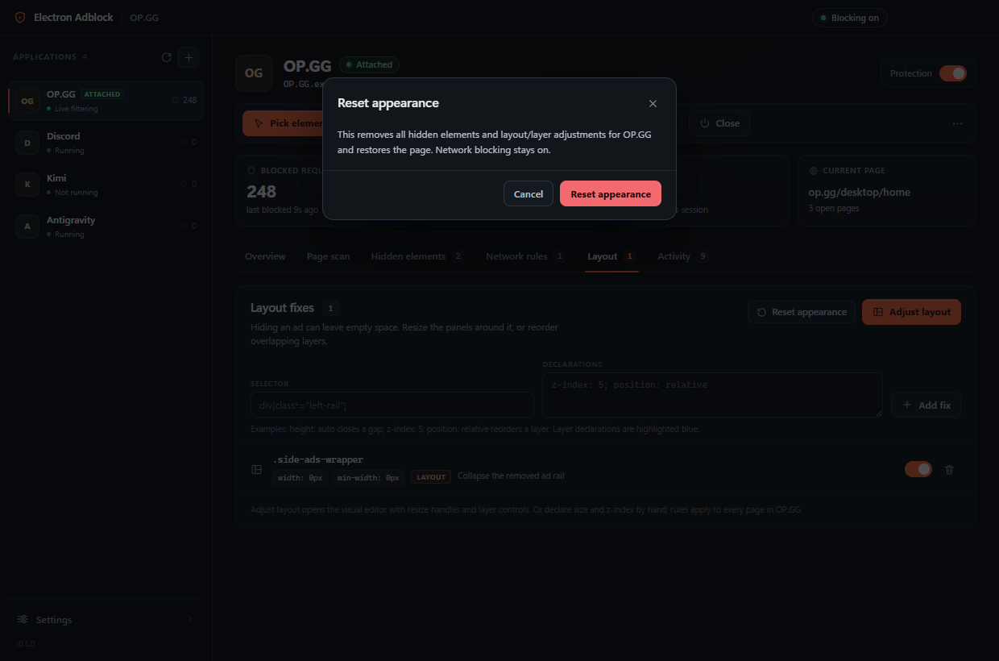
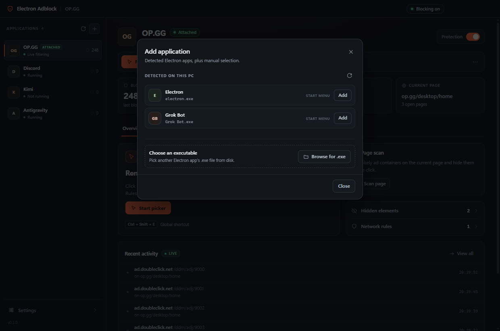

# Electron Adblock

[](https://github.com/terri-yaki/electron-adblock/actions/workflows/ci.yml)
[](https://github.com/terri-yaki/electron-adblock/releases/latest)
[](LICENSE)
[](#requirements)

A desktop ad blocker for Electron applications on Windows. It launches any Electron app with a local DevTools port, attaches over the Chrome DevTools Protocol, blocks ad and tracker requests before they leave the machine, and lets you hide any element with your mouse. Layout and layer order can be adjusted after hiding, and one click restores the original page. Works with hidden-window apps such as Overwolf-based TFTAcademy as well as regular Electron apps like OP.GG.

**Download the latest portable build:** [Releases](https://github.com/terri-yaki/electron-adblock/releases/latest)



## Why this exists

Electron apps are Chromium applications, but regular browser extensions do not apply to them. Electron Adblock treats each app as its own browsing context: it relaunches the app with debugging enabled, then uses the Chrome DevTools Protocol to block ad requests and inject the same kind of cosmetic filtering a browser ad blocker would. Element hiding is visual and saved per app, so you can remove exactly the ad panels that annoy you without writing selectors by hand.

## Features

- **Network ad blocking** - a curated list of ad and tracker hosts is rejected inside the app; per-app domains and URL globs can be added.
- **Visual element picker** - hover an element in the target app, click to hide it, Alt+click to hide its parent, Esc to finish. The picker shows how many elements the generated selector matches.
- **Page scan** - finds likely ad containers (ad-like ids/classes, ad iframes, adsbygoogle units) and offers one-click hiding.
- **Layout adjustment** - hiding an ad can leave an empty panel. Select the leftover panel, drag its resize handles or use Fill width / Fill height / Auto, then Save. Front / Forward / Backward / Back reorder overlapping layers through position and z-index overrides.
- **Reset appearance** - one button removes every hide rule and layout/layer adjustment for an app and restores the page; network blocking stays on.
- **Hidden-window support** - apps that keep their windows out of the Chromium target list (Overwolf runtime / custom schemes such as TFTAcademy) are driven through a local main-process inspector engine.
- **Per-app rules** - cosmetic, network and layout rules are stored per application, with a per-app pause switch and a global master switch.
- **Live activity** - blocked requests stream into the Activity panel with page context.
- **Resident tray app** - global picker hotkey (default Ctrl+Shift+E), start with Windows, portable exe.

## Screenshots

| OP.GG dashboard | TFTAcademy hidden-window picker |
| --- | --- |
|  |  |

| Layout and layer editor | Layout rules |
| --- | --- |
|  |  |

| Reset appearance | Add application |
| --- | --- |
|  |  |

## Requirements

- Windows 10 or 11, x64.
- Node.js 20 or newer for development. The portable release needs no runtime.
- Applications must be started through Electron Adblock (or already expose a debugging port).

## Download and install

1. Download `Electron-Adblock-<version>-win-x64-portable.exe` from the [latest release](https://github.com/terri-yaki/electron-adblock/releases/latest).
2. Run it. The build is unsigned, so Windows SmartScreen may show a warning: **More info -> Run anyway**.
3. The app lives in the tray. No installer, services or admin rights required.

Verify the download with the `SHA256SUMS.txt` asset attached to the release.

## Quick start from source

```bash
git clone https://github.com/terri-yaki/electron-adblock.git
cd electron-adblock
npm install
npm start
```

Build the portable executable:

```bash
npm run package
```

The output is `release/Electron-Adblock-portable.exe`.

## Using it

1. Click **Add application** and choose a detected Electron app, or browse for its `.exe`.
2. Click **Relaunch under ad blocking** (or **Launch** when it is not running). The app restarts with local debugging ports and becomes attached.
3. Click **Pick element**, switch to the target app, hover the ad and click it. Press Esc when finished. Alt+click hides the parent container.
4. Or click **Scan page** and hide suggested ad containers.
5. Click **Adjust layout** to close the gap an ad left behind: select a panel, drag its handles or use Fill width / Fill height / Auto, reorder layers with Front / Forward / Backward / Back if needed, then Save.
6. Add custom ad hosts under **Network rules** if something slips through.
7. To undo everything for an app, use **Reset appearance**. Network blocking is kept.

The global hotkey targets the most recently attached app. Closing the window keeps Electron Adblock in the tray.

## How it works

1. **Discovery** merges Start Menu shortcuts, installed-program registry entries, common install folders, and running Electron process trees, deduplicated by executable path.
2. **Launch/attach**: the chosen app starts with `--remote-debugging-port=<free port>` (plus a local Node inspector port for hidden-window apps). Electron Adblock connects to the browser-level CDP endpoint.
3. **Filtering**: for every page/webview target it injects a content script, enables CDP Fetch interception for configured ad patterns, and applies a constructed stylesheet. Matching requests fail locally.
4. **Hidden windows**: if an app hides its windows from the target list, a second engine talks to the app main process over the Node inspector and applies the same rules and picker to those windows. Windows already covered by CDP are skipped, and no foreign debugger is detached.
5. **Picking and layout**: an injected overlay provides hover/click picking, resize handles, layer controls and the page scanner. Rules are saved by the host and pushed back to every frame.
6. **Storage**: rules live in a local JSON file. There is no account, cloud service or telemetry.

## Security and trust

- All debugging ports are bound to localhost and exist only while the target app runs. They give local processes control over the app, so treat them like DevTools.
- Electron Adblock never connects to the internet for ad lists, telemetry or updates. It only talks to the apps you attach.
- Rules and settings are stored in `%APPDATA%\Electron Adblock\adblock-data.json`; deleting that file while the app is closed resets everything.
- Blocking ads may conflict with an application terms of service. Use this on apps you are allowed to modify on your own machine.

## Limitations

- Windows-only launcher; macOS and Linux are not supported yet.
- Apps must be started through Electron Adblock (or already expose a debugging port).
- Apps using hardened Electron fuses or anti-cheat that reject the debugging/inspect flags cannot be attached.
- Cross-origin ad iframes are generally stopped by network blocking; cosmetic hiding works in frames you can interact with.
- The portable executable is unsigned.

## Development

```bash
npm install
npm run build        # esbuild bundles main, preload, injected script and renderer
npm run typecheck    # tsc --noEmit
npm run test:unit    # node:test unit suites (no GUI required)
npm test             # build + unit + Electron integration suites
npm run shot -- --mock --out _shots/ui.png   # visual snapshot with mock data
```

`npm test` launches a real Electron fixture and a local fake ad server, so run it on a machine with a desktop session. `tests/unit` is safe for CI.

### Project layout

- `src/main/main.ts` - Electron lifecycle, window, tray, hotkey, IPC wiring.
- `src/main/app-service.ts` - orchestration: discovery, launch, attach, rules, stats, events.
- `src/main/engine/` - CDP engine, inspector fallback engine, combined engine and URL patterns.
- `src/main/apps/` - Windows discovery/registry/install scans, launcher, process and port helpers.
- `src/injected/` - cosmetic engine, picker, layout/layer editor, selector builder, page scanner.
- `src/renderer/` - dashboard UI.
- `fixture/` and `tests/` - a real Electron test app, local ad server and CDP integration tests.

Mock mode (`EAB_MOCK=1`) serves canned apps and events so the UI can be developed without launching other applications.

## Contributing

Bug reports and pull requests are welcome. Read [CONTRIBUTING.md](CONTRIBUTING.md) and follow the [Code of Conduct](CODE_OF_CONDUCT.md). For security issues use [SECURITY.md](SECURITY.md) instead of a public issue.

## License

[MIT](LICENSE) (c) 2026 Terabase.